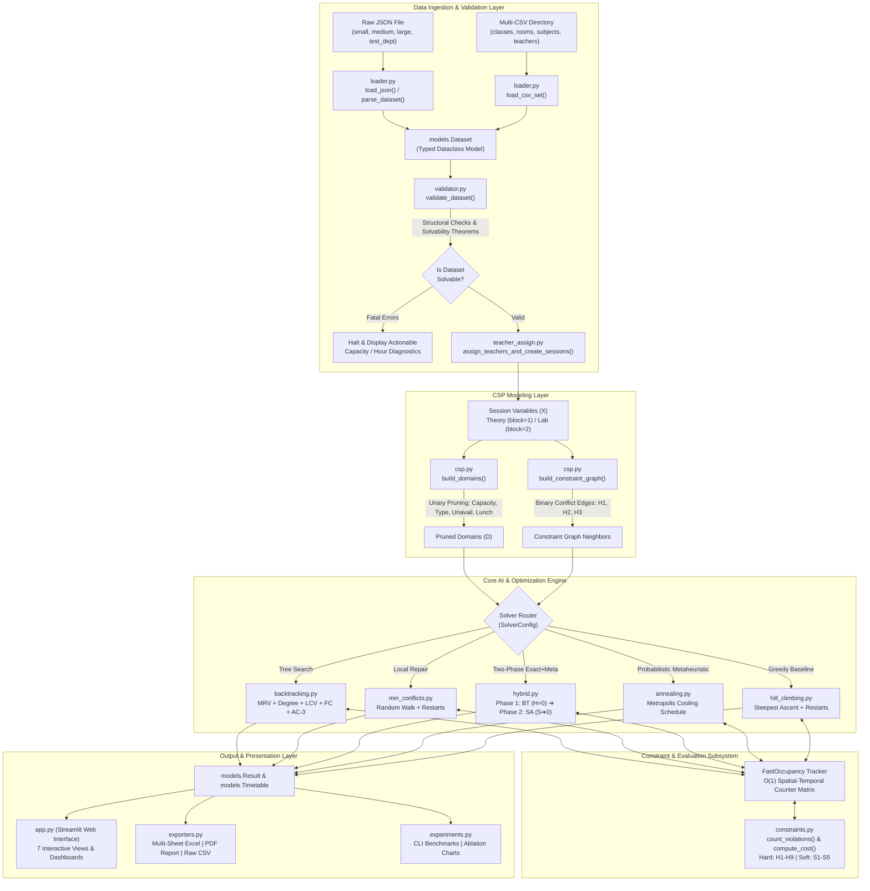
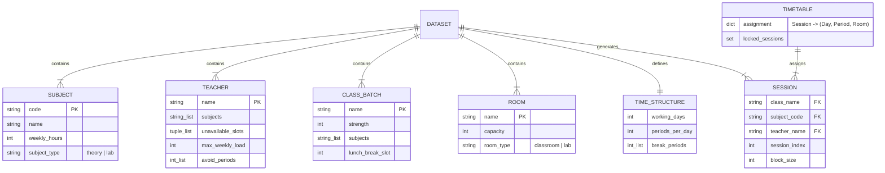

# 🎓 AI-Based University Timetable Scheduler Using CSP, Min-Conflicts & Metaheuristics

[](https://www.python.org/)
[](https://streamlit.io/)
[](tests/test_core.py)
[]()
[]()

> **Academic Project Submission & Technical Reference**  
> An enterprise-grade, constraint-satisfaction and metaheuristic timetabling engine. Formulates academic schedule generation as a **Constraint Satisfaction Problem (CSP)** with multi-objective optimization, featuring five distinct AI algorithms, pre-solver solvability validation, an interactive Streamlit UI, multi-format exports (CSV, multi-tab Excel, and printable PDF), and a comprehensive empirical benchmarking suite.

---

## 📑 Table of Contents
1. [Executive Summary & Problem Statement](#1-executive-summary--problem-statement)
2. [System Architecture & Design Patterns](#2-system-architecture--design-patterns)
3. [End-to-End Data Flow & State Lifecycle](#3-end-to-end-data-flow--state-lifecycle)
4. [Formal CSP Mathematical Formulation](#4-formal-csp-mathematical-formulation)
   - [Variables, Domains & Constraint Predicates](#variables-domains--constraint-predicates)
   - [Hard Constraints (H1 – H9)](#hard-constraints-h1--h9)
   - [Soft Constraints (S1 – S5)](#soft-constraints-s1--s5)
   - [Global Cost Function](#global-cost-function)
5. [AI Solver Paradigms & Algorithmic Mechanics](#5-ai-solver-paradigms--algorithmic-mechanics)
   - [1. Informed CSP Backtracking (MRV + Degree + LCV + FC + AC-3)](#1-informed-csp-backtracking)
   - [2. Min-Conflicts Local Search (Random Walk + Restarts)](#2-min-conflicts-local-search)
   - [3. Two-Phase Hybrid Solver (Production Recommended)](#3-two-phase-hybrid-solver-production-recommended)
   - [4. Simulated Annealing Metaheuristic](#4-simulated-annealing-metaheuristic)
   - [5. Steepest-Ascent Hill Climbing Baseline](#5-steepest-ascent-hill-climbing-baseline)
6. [Data Architecture & Schemas](#6-data-architecture--schemas)
7. [Exhaustive Codebase & Function Reference](#7-exhaustive-codebase--function-reference)
   - [core/models.py](#coremodelspy)
   - [core/loader.py](#coreloaderpy)
   - [core/validator.py](#corevalidatorpy)
   - [core/constraints.py](#coreconstraintspy)
   - [core/teacher_assign.py](#coreteacher_assignpy)
   - [core/csp.py](#corecsppy)
   - [core/backtracking.py](#corebacktrackingpy)
   - [core/min_conflicts.py](#coremin_conflictspy)
   - [core/annealing.py](#coreannealingpy)
   - [core/hybrid.py](#corehybridpy)
   - [core/hill_climbing.py](#corehill_climbingpy)
   - [core/exporters.py](#coreexporterspy)
   - [core/experiments.py](#coreexperimentspy)
   - [ui/styles.py](#uistylespy)
   - [app.py](#apppy)
   - [data/generate_datasets.py](#datagenerate_datasetspy)
   - [tests/test_core.py](#teststest_corepy)
8. [Streamlit Web Interface Architecture](#8-streamlit-web-interface-architecture)
9. [Empirical Benchmarks & Experimental Results](#9-empirical-benchmarks--experimental-results)
10. [Evaluator & Viva Voce Defense Guide](#10-evaluator--viva-voce-defense-guide)
11. [Installation, Verification & Quickstart](#11-installation-verification--quickstart)
12. [Limitations & Future Roadmap](#12-limitations--future-roadmap)

---

## 1. Executive Summary & Problem Statement

University course timetabling requires allocating scheduled slots (Day, Period, Room) to every academic lecture and laboratory session across multiple classes, faculty members, and physical venues.

### The Complexity Challenge
Course timetabling is mathematically proven to be **NP-complete** (reducible from 3-SAT and Graph Multi-Coloring). A naïve brute-force search over $N$ sessions with $|D|$ legal time-room slots yields a combinatorial search space of:
$$\text{Search Space Size} = |D|^N$$
For a moderate single department (e.g., $N = 72$ sessions, $|D| = 150$ slots), the state space exceeds $150^{72} \approx 10^{156}$ combinations—more than the number of atoms in the observable universe ($10^{80}$).

### Project Solution
This project solves the timetabling problem by decoupling the solution into:
1. **Mathematical CSP Modeling**: Pruning search domains before solving using unary constraints.
2. **Informed Heuristic Search**: Using fails-first variable selection (MRV) and early dead-end elimination (Forward Checking).
3. **High-Performance Collision Tracking**: Employing `FastOccupancy` to achieve $\mathcal{O}(1)$ clash detection instead of $\mathcal{O}(n^2)$ pairwise comparisons.
4. **Two-Phase Hybrid Architecture**: Leveraging exact backtracking for zero hard-constraint violations ($H=0$) and metaheuristic simulated annealing for soft constraint quality ($S \to 0$).
5. **Human-in-the-Loop Web Interface**: Providing interactive conflict-checked drag-and-drop manual editing and multi-format exports.

---

## 2. System Architecture & Design Patterns

The codebase is built on strict software engineering principles:
* **Separation of Concerns**: The core AI and constraint logic (`core/`) is 100% pure Python with zero UI dependencies, allowing it to be executed via CLI, web app, or batch scripts.
* **Immutability & Type Safety**: Entities (`Subject`, `Room`, `Session`) use frozen dataclasses to allow hashing and constant-time set lookups.
* **Single Source of Truth**: `core/constraints.py` provides the canonical violation-checking logic used identically by the solvers, the manual editor, and the test suite.

### Comprehensive System Architecture Diagram



---

## 3. End-to-End Data Flow & State Lifecycle

The complete lifecycle of data from initial file parsing to final timetable export proceeds through seven distinct, deterministic stages:

```mermaid
sequenceDiagram
    autonumber
    actor User as User / Evaluator
    participant UI as Streamlit UI (app.py)
    participant Loader as loader.py
    participant Val as validator.py
    participant Assign as teacher_assign.py
    participant CSP as csp.py
    participant Solver as AI Solver Engine
    participant Const as constraints.py / FastOccupancy
    participant Export as exporters.py

    User->>UI: Select Benchmark or Upload Dataset (JSON/CSV)
    UI->>Loader: Parse raw file inputs
    Loader-->>UI: Return typed Dataset object
    UI->>Val: validate_dataset(dataset)
    Note over Val: Verify structural integrity,<br/>class hours vs available slots,<br/>room capacity & teacher workload
    Val-->>UI: Return (errors, warnings)

    alt Fatal Solvability Errors Found
        UI-->>User: Display detailed error diagnostics & abort
    else Solvability Confirmed
        UI->>Assign: assign_teachers_and_create_sessions(dataset)
        Note over Assign: Greedy load balancing among eligible faculty;<br/>create Session variables with block_size
        Assign-->>UI: Instantiated Session list

        User->>UI: Select Solver & Heuristic Toggles -> Click "Generate"
        UI->>CSP: build_domains(dataset) & build_constraint_graph(dataset)
        Note over CSP: Unary pruning removes room/type/availability mismatches
        CSP-->>Solver: Initialized Domains & Constraint Graph

        UI->>Solver: solve_*(dataset, config)
        loop Solving & Conflict Evaluation
            Solver->>Const: count_conflicts(session, slot, room)
            Const-->>Solver: O(1) conflict counts via FastOccupancy
        end
        Solver-->>UI: Return Result(timetable, cost, runtime, violations)

        UI->>UI: Render interactive schedule grids (Class, Teacher, Master)
        User->>UI: Request Export (PDF / Excel / CSV)
        UI->>Export: export_*(timetable, dataset)
        Export-->>User: Download finalized publication-ready schedules
    end
```

---

## 4. Formal CSP Mathematical Formulation

A Constraint Satisfaction Problem is formally defined as a tuple:
$$\mathcal{P} = \langle X, D, C \rangle$$

### Variables, Domains & Constraint Predicates
* **Variables ($X$)**:
  $$X = \{S_1, S_2, \dots, S_N\}$$
  Each variable $S_i$ represents an indivisible teaching requirement:
  $$S_i = \langle \text{class}(S_i), \text{subject}(S_i), \text{teacher}(S_i), \text{index}(S_i), \text{block\_size}(S_i) \rangle$$
  For theory lectures, $\text{block\_size} = 1$. For lab sessions in block mode, $\text{block\_size} = 2$.
* **Domains ($D$)**:
  For each variable $S_i$, its domain $D(S_i)$ is the set of legal start slot coordinates:
  $$D(S_i) \subseteq \{ (d, p, r) \mid 0 \le d < \text{days},\, 0 \le p < \text{periods},\, r \in \text{Rooms} \}$$
  Pruned during domain generation by unary constraints.
* **Constraints ($C$)**:
  Partitioned into **Hard Constraints ($H$)** that define feasibility and **Soft Constraints ($S$)** that define quality.

---

### Hard Constraints (H1 – H9)
*Zero violations tolerated. Any schedule violating a hard constraint is invalid.*

```
┌────────────────────────────────────────────────────────────────────────┐
│                        HARD CONSTRAINTS (H1 - H9)                      │
├──────┬──────────────────────┬──────────────────────────────────────────┤
│ Code │ Name                 │ Mathematical Invariant                   │
├──────┼──────────────────────┼──────────────────────────────────────────┤
│  H1  │ Teacher Clash        │ No teacher in two places at once         │
│  H2  │ Class Clash          │ No student batch in two places at once   │
│  H3  │ Room Clash           │ No room hosting two sessions at once     │
│  H4  │ Room Capacity        │ Room capacity >= class student strength  │
│  H5  │ Room Type Match      │ Labs in lab rooms; Theory in classrooms  │
│  H6  │ Teacher Availability │ Sessions cannot use unavailable slots    │
│  H7  │ Weekly Contact Hours │ Assigned weekly hours == required hours  │
│  H8  │ Teacher Workload     │ Assigned load <= faculty max_weekly_load │
│  H9  │ Lunch Break Slot     │ Class cannot have lectures during lunch  │
└──────┴──────────────────────┴──────────────────────────────────────────┘
```

1. **$H_1$ — Teacher Clash**:
   $$\forall S_i, S_j \, (i \neq j): \text{teacher}(S_i) = \text{teacher}(S_j) \implies \text{Slots}(S_i) \cap \text{Slots}(S_j) = \emptyset$$
2. **$H_2$ — Class Clash**:
   $$\forall S_i, S_j \, (i \neq j): \text{class}(S_i) = \text{class}(S_j) \implies \text{Slots}(S_i) \cap \text{Slots}(S_j) = \emptyset$$
3. **$H_3$ — Room Clash**:
   $$\forall S_i, S_j \, (i \neq j): \text{room}(S_i) = \text{room}(S_j) \implies \text{Slots}(S_i) \cap \text{Slots}(S_j) = \emptyset$$
4. **$H_4$ — Room Capacity**:
   $$\forall S_i: \text{Capacity}(\text{room}(S_i)) \ge \text{Strength}(\text{class}(S_i))$$
5. **$H_5$ — Room Type Matching**:
   $$\forall S_i: \text{Type}(\text{room}(S_i)) = \text{Type}(\text{subject}(S_i))$$
6. **$H_6$ — Teacher Availability**:
   $$\forall S_i: \text{Slots}(S_i) \cap \text{Unavailable}(\text{teacher}(S_i)) = \emptyset$$
7. **$H_7$ — Weekly Contact Hours**:
   $$\forall c, s: \sum_{S_i \in \text{Sessions}(c, s)} \text{block\_size}(S_i) = \text{WeeklyHours}(s)$$
8. **$H_8$ — Teacher Workload Cap**:
   $$\forall t: \sum_{S_i \in \text{Sessions}(t)} \text{block\_size}(S_i) \le \text{MaxWeeklyLoad}(t)$$
9. **$H_9$ — Lunch Break Protection**:
   $$\forall S_i: \text{Slots}(S_i) \cap \{(d, \text{Lunch}(\text{class}(S_i)))\} = \emptyset$$

---

### Soft Constraints (S1 – S5)
*Multi-objective minimization using configurable weights ($w_1 \dots w_5$).*

1. **$S_1$ — Student Idle Gaps ($w_1 = 2.0$)**:
   Minimizes non-instructional waiting periods between a class batch's earliest and latest lecture on any single day (excluding lunch).
2. **$S_2$ — Subject Dispersion ($w_2 = 2.0$)**:
   Penalizes scheduling multiple theory lectures of the same subject on the same day for a class batch, promoting balanced learning spread.
3. **$S_3$ — Laboratory Continuity ($w_3 = 3.0$)**:
   Ensures multi-hour laboratory sessions occur in contiguous consecutive periods without interruptions.
4. **$S_4$ — Teacher Slot Preferences ($w_4 = 1.0$)**:
   Penalizes scheduling faculty in timeslots listed in their personal `avoid_periods` preference list.
5. **$S_5$ — Faculty Load Smoothing ($w_5 = 2.0$)**:
   Penalizes runs of $> 2$ consecutive teaching hours for any faculty member without a rest period.

### Global Cost Function
The objective function evaluates the total penalty of any complete or partial timetable:
$$\mathcal{C}(\text{Timetable}) = 1000 \times \sum_{k=1}^9 |\text{violations}(H_k)| + \sum_{m=1}^5 w_m \times |\text{violations}(S_m)|$$
* **Hard Feasibility Criterion**: A timetable is strictly valid and feasible if and only if $\mathcal{C} < 1000$ (which guarantees zero hard violations).

---

## 5. AI Solver Paradigms & Algorithmic Mechanics

### 1. Informed CSP Backtracking
A systematic, complete tree-search algorithm enhanced with state-of-the-art CSP heuristics:

```
               [Select Unassigned Variable via MRV / Degree]
                                      │
                        [Order Values via LCV]
                                      │
                         [Assign (Day, Period, Room)]
                                      │
                      [Forward Checking / AC-3 Pruning]
                                      │
                  ┌───────────────────┴───────────────────┐
              [Valid]                                 [Domain Wipeout]
                 │                                           │
         [Next Variable]                              [Backtrack & Restore]
```

* **Minimum Remaining Values (MRV)**: Selects variable $S = \arg\min_{S \in \text{Unassigned}} |D(S)|$. Minimizes the branching factor of the search tree.
* **Degree Heuristic**: Breaks MRV ties by selecting the variable involved in the largest number of constraints with remaining unassigned variables.
* **Least Constraining Value (LCV)**: Orders domain values $(d, p, r)$ to prioritize slots that eliminate the fewest choices from neighboring unassigned variables.
* **Forward Checking (FC)**: When $S_i \leftarrow (d, p, r)$ is committed, conflicting slots are immediately pruned from the domains of all unassigned neighbors. If any neighbor domain reaches size 0, search backtracks immediately.
* **AC-3 (Arc Consistency)**: Preprocessing algorithm enforcing pairwise arc consistency across all binary constraints before search begins.

---

### 2. Min-Conflicts Local Search
A fast repair heuristic operating on complete states:
1. **Initial Assignment**: Starts with a complete schedule generated either randomly or via greedy conflict minimization.
2. **Conflict Tracking**: Uses `FastOccupancy` to maintain constant-time clash lookups.
3. **Iterative Repair**:
   * Randomly selects a conflicted session variable $S_i$.
   * Computes the conflict count for all candidate values $v \in D(S_i)$.
   * Transitions to the value that minimizes total hard conflicts.
4. **Plateau & Cycle Avoidance**:
   * **Random Walk**: With probability $p \in [0.02, 0.15]$, selects a random valid domain value instead of the greedily optimal value.
   * **Random Restarts**: If search fails to reach $H=0$ within `restart_after` iterations (default 2,000), resets to a new random state.

---

### 3. Two-Phase Hybrid Solver (Production Recommended)
Combines exact tree search with metaheuristic optimization:

```
  ┌─────────────────────────────────────────────────────────────┐
  │ Phase 1: Informed Backtracking (Exact Search)               │
  │ • Half-time budget allocation                               │
  │ • MRV + Degree + Forward Checking enabled                   │
  │ • Guarantees finding a hard-feasible schedule (H = 0)       │
  └──────────────────────────────┬──────────────────────────────┘
                                 ▼
                    Feasible Timetable (H = 0)
                                 │
  ┌──────────────────────────────┴──────────────────────────────┐
  │ Phase 2: Constrained Simulated Annealing (Metaheuristic)    │
  │ • Seeded with Phase 1 feasible timetable                    │
  │ • Explores Move, Swap, and Room-Switch neighborhood moves   │
  │ • Hard Constraint Gate: Any move with H > 0 is REJECTED     │
  │ • Drives soft penalties down to optimal (S ➔ 0)             │
  └──────────────────────────────┬──────────────────────────────┘
                                 ▼
                 Optimal Final Timetable (H=0, S=0)
```

---

### 4. Simulated Annealing Metaheuristic
Probabilistic local search for unconstrained or soft optimization:
* **Neighborhood Operators**:
  1. *Move*: Relocate a session to another valid slot in its domain.
  2. *Swap*: Exchange slots between two assigned sessions.
  3. *Room Switch*: Change only the room for a session at the same day and period.
* **Acceptance Rule (Metropolis Criterion)**:
  $$\Delta \mathcal{C} = \mathcal{C}_{\text{new}} - \mathcal{C}_{\text{current}}$$
  $$\text{Probability} = \begin{cases} 1 & \text{if } \Delta \mathcal{C} \le 0 \\ \exp\left(-\frac{\Delta \mathcal{C}}{T}\right) & \text{if } \Delta \mathcal{C} > 0 \end{cases}$$
* **Geometric Cooling**: $T_{k+1} = \alpha \cdot T_k$ with $\alpha = 0.995$.

---

### 5. Steepest-Ascent Hill Climbing Baseline
Deterministic local search:
* Evaluates all 1-move neighbors of conflicted variables.
* Greedily transitions to the neighbor with the largest cost decrease.
* Incorporates random restarts upon encountering local optima.

---

## 6. Data Architecture & Schemas

### Entity Relationship Model



---

## 7. Exhaustive Codebase & Function Reference

A comprehensive module-by-module reference documenting all classes, methods, functions, and parameters across the entire codebase.

---

### `core/models.py`
Defines all type-annotated dataclasses representing domain entities, configurations, and solver outputs.

#### Classes & Methods

##### `Subject`
*Frozen dataclass representing a course.*
* **Fields**: `code: str`, `name: str`, `weekly_hours: int`, `subject_type: str ("theory" | "lab")`.
* **Methods**:
  * `__post_init__()`: Validates that `subject_type` is either `"theory"` or `"lab"` and that `weekly_hours >= 1`. Raises `ValueError` on failure.

##### `Teacher`
*Dataclass representing a faculty member.*
* **Fields**: `name: str`, `subjects: list[str]`, `unavailable_slots: list[tuple[int, int]]`, `max_weekly_load: int`, `avoid_periods: list[int]`.
* **Methods**:
  * `__hash__()`: Returns `hash(self.name)` for dictionary lookup.
  * `__eq__(other)`: Checks equality based on teacher name.

##### `ClassBatch`
*Dataclass representing a cohort of students.*
* **Fields**: `name: str`, `strength: int`, `subjects: list[str]`, `lunch_break_slot: int`.
* **Methods**:
  * `__hash__()`: Returns `hash(self.name)`.
  * `__eq__(other)`: Equality based on batch name.

##### `Room`
*Frozen dataclass representing a teaching facility.*
* **Fields**: `name: str`, `capacity: int`, `room_type: str ("classroom" | "lab")`.
* **Methods**:
  * `__post_init__()`: Validates `room_type in ("classroom", "lab")`.

##### `TimeStructure`
*Dataclass configuring weekly dimensions.*
* **Fields**: `working_days: int`, `periods_per_day: int`, `break_periods: list[int]`.
* **Methods**:
  * `day_names -> list[str]`: Property returning day strings (`["Monday", "Tuesday", ...]`).
  * `is_valid_slot(day: int, period: int) -> bool`: Verifies coordinates lie within boundary ranges.

##### `Session`
*Frozen dataclass serving as the individual CSP variable.*
* **Fields**: `class_name: str`, `subject_code: str`, `session_index: int`, `teacher_name: str`, `block_size: int = 1`.
* **Methods**:
  * `label() -> str`: Returns formatted display string (e.g., `"CSE-A | CS301 #1"`).

##### `Timetable`
*Wraps candidate assignments.*
* **Fields**: `assignment: dict[Session, tuple[int, int, str] | None]`, `locked_sessions: set[Session]`.
* **Methods**:
  * `get_slot(session: Session) -> tuple[int, int, str] | None`: Returns assigned slot.
  * `set_slot(session: Session, day: int, period: int, room: str)`: Mutates session assignment.
  * `is_complete() -> bool`: Returns `True` if all sessions have non-None assignments.

##### `ViolationDetail`
*Encapsulates a single constraint infringement.*
* **Fields**: `code: str`, `message: str`, `sessions: list`, `day: int`, `period: int`.

##### `ViolationReport`
*Comprehensive evaluation output.*
* **Fields**: `hard_violations: list[ViolationDetail]`, `soft_violations: list[ViolationDetail]`, `hard_count: int`, `soft_penalty: float`, `cost: float`, `per_code: dict[str, int]`.

##### `SolverConfig`
*Runtime configuration parameters passed to all solvers.*
* **Fields**:
  * `seed: int = 42`, `time_limit: float = 60.0`, `max_nodes: int = 200_000`, `max_iterations: int = 20_000`
  * Heuristic flags: `use_mrv: bool = True`, `use_degree: bool = True`, `use_lcv: bool = False`, `use_forward_checking: bool = True`, `use_ac3: bool = False`
  * Min-Conflicts: `random_walk_prob: float = 0.02`, `restart_after: int = 2000`
  * Simulated Annealing: `sa_initial_temp: float = 100.0`, `sa_cooling_alpha: float = 0.995`, `sa_iterations_per_temp: int = 50`, `sa_min_temp: float = 0.01`
  * Soft weights: `weight_s1: float = 2.0`, `weight_s2: float = 2.0`, `weight_s3: float = 3.0`, `weight_s4: float = 1.0`, `weight_s5: float = 2.0`
  * Lab configuration: `lab_block_size: int = 2`, `lab_mode: str = "block"`

##### `Result`
*Standardized output returned by every solver.*
* **Fields**: `timetable: Timetable | None`, `success: bool`, `hard_violations: int`, `soft_penalty: float`, `cost: float`, `time_seconds: float`, `nodes_or_iterations: int`, `cost_history: list[float]`, `status: str`, `algorithm: str`, `metadata: dict`.

##### `Dataset`
*Unified container bundling all input data.*
* **Fields**: `subjects: dict[str, Subject]`, `teachers: dict[str, Teacher]`, `classes: dict[str, ClassBatch]`, `rooms: dict[str, Room]`, `time_structure: TimeStructure`, `sessions: list[Session]`, `subject_teachers: dict[str, list[str]]`.
* **Methods**:
  * `build_subject_teachers()`: Precomputes inverse mapping of which teachers can teach each subject.

---

### `core/loader.py`
Handles ingestion of raw JSON and multi-CSV inputs into typed `Dataset` objects.

#### Functions
* **`load_json(source: str | io.IOBase | dict) -> dict`**:
  * Loads raw data from a file path, file-like buffer (Streamlit upload), or existing dictionary.
* **`parse_dataset(raw: dict) -> Dataset`**:
  * Parses raw dictionary into validated `Dataset` object. Performs comprehensive field verification and raises descriptive `ValueError` on missing fields.
* **`load_csv_set(subjects_file, teachers_file, classes_file, rooms_file, working_days=5, periods_per_day=6) -> dict`**:
  * Ingests 4 CSV files using pandas, parses semicolon-separated lists (`subjects`, `unavailable_slots`), and formats data into standard dictionary schema.
* **`dataset_to_json(dataset: Dataset) -> dict`**:
  * Serializes a typed `Dataset` object back into a standard dictionary schema for saving.

---

### `core/validator.py`
Executes pre-solving feasibility checks before any solver executes.

#### Functions
* **`validate_dataset(dataset: Dataset) -> tuple[list[str], list[str]]`**:
  * *Structural Verifications*:
    1. Checks for duplicate IDs among subjects, teachers, classes, and rooms.
    2. Verifies that all subjects referenced by classes exist in `dataset.subjects`.
    3. Confirms that every required subject has at least one qualified teacher.
    4. Validates that lunch slots and unavailable slots fall within valid `(day, period)` bounds.
    5. Confirms that each lab subject has at least one lab room large enough for the class.
  * *Solvability Pre-Checks*:
    1. Compares total weekly hours needed by each class against available weekly periods (after deducting lunch and break periods).
    2. Evaluates teacher load feasibility against `max_weekly_load` and unavailable slots.
    3. Verifies total room-slot availability per room type (`classroom` vs `lab`) against required session hours.
  * *Returns*: `(errors, warnings)`. An empty `errors` list indicates the dataset is mathematically solvable.

---

### `core/constraints.py`
The single source of truth for constraint evaluation across all solvers, UI editors, and benchmarks.

#### Helper Functions
* **`_build_occupancy(timetable: Timetable, dataset: Dataset) -> tuple[dict, dict, dict]`**:
  * Constructs lookup tables: `teacher_at[(day, period)]`, `class_at[(day, period)]`, and `room_at[(day, period, room)]`.
  * Handles multi-period lab blocks by populating entries for all consecutive offsets $[0, \text{block\_size}-1]$.
  * Eliminates $\mathcal{O}(n^2)$ pairwise loops in constraint checking.

#### Hard Constraint Checkers ($H_1 - H_9$)
* **`_check_h1_teacher_clash(teacher_at, dataset) -> list[ViolationDetail]`**: Flags instances where a teacher is assigned $> 1$ session in the same slot.
* **`_check_h2_class_clash(class_at, dataset) -> list[ViolationDetail]`**: Flags instances where a student batch has $> 1$ session in the same slot.
* **`_check_h3_room_clash(room_at, dataset) -> list[ViolationDetail]`**: Flags instances where a room hosts $> 1$ session in the same slot.
* **`_check_h4_room_capacity(timetable, dataset) -> list[ViolationDetail]`**: Flags sessions where `room.capacity < class.strength`.
* **`_check_h5_room_type(timetable, dataset) -> list[ViolationDetail]`**: Flags theory sessions scheduled in labs or lab sessions scheduled in classrooms.
* **`_check_h6_teacher_availability(timetable, dataset) -> list[ViolationDetail]`**: Flags sessions placed in a teacher's `unavailable_slots`.
* **`_check_h7_weekly_hours(timetable, dataset) -> list[ViolationDetail]`**: Flags discrepancies between assigned weekly hours and required `subject.weekly_hours`.
* **`_check_h8_teacher_load(timetable, dataset) -> list[ViolationDetail]`**: Flags teachers whose total scheduled hours exceed `max_weekly_load`.
* **`_check_h9_lunch_break(timetable, dataset) -> list[ViolationDetail]`**: Flags sessions scheduled during a class batch's designated lunch period.

#### Soft Constraint Checkers ($S_1 - S_5$)
* **`_check_s1_gaps(timetable, dataset) -> list[ViolationDetail]`**: Identifies idle gaps between the first and last period of each day for each class.
* **`_check_s2_subject_spread(timetable, dataset) -> list[ViolationDetail]`**: Identifies repeat theory lectures for the same subject within a single day.
* **`_check_s3_lab_consecutive(timetable, dataset) -> list[ViolationDetail]`**: Checks whether split lab sessions are scheduled contiguously.
* **`_check_s4_teacher_preferences(timetable, dataset) -> list[ViolationDetail]`**: Flags assignments placed in periods a teacher prefers to avoid.
* **`_check_s5_teacher_consecutive(timetable, dataset) -> list[ViolationDetail]`**: Flags runs of $> 2$ consecutive teaching hours for any faculty member.

#### Core Evaluation Functions
* **`count_violations(timetable: Timetable, dataset: Dataset, config: SolverConfig | None = None) -> ViolationReport`**:
  * Runs all $H_1 - H_9$ and $S_1 - S_5$ checkers, calculates weighted penalties, computes total cost $\mathcal{C}$, and populates `ViolationReport`.
* **`compute_cost(timetable: Timetable, dataset: Dataset, config: SolverConfig | None = None) -> float`**:
  * Convenience wrapper returning `count_violations(...).cost`.
* **`count_conflicts_for_assignment(session: Session, value: tuple[int, int, str], current_assignment: dict, dataset: Dataset) -> int`**:
  * Rapidly counts conflicts resulting from assigning `value` to `session` against existing assignments. Used for backtracking consistency checks and Min-Conflicts value selection.

#### `FastOccupancy` Class
High-performance incremental collision tracker providing $\mathcal{O}(1)$ clash detection.
* **`add(session: Session, day: int, period: int, room: str)`**: Increments counters for teacher, class, and room across all block periods.
* **`remove(session: Session, day: int, period: int, room: str)`**: Decrements and cleans up zero counters.
* **`count_conflicts(session: Session, day: int, period: int, room: str, dataset: Dataset) -> int`**: Evaluates potential conflicts in $\mathcal{O}(1)$ time without scanning other sessions.

---

### `core/teacher_assign.py`
Assigns teachers to classes and generates concrete `Session` variables.

#### Functions
* **`assign_teachers_and_create_sessions(dataset: Dataset, config: SolverConfig | None = None) -> list[Session]`**:
  * Selects qualified teachers with lowest current workload (greedy balancing).
  * Instantiates `Session` objects with appropriate `block_size` (1 for theory, 2 for labs in block mode).
  * Sets `dataset.sessions` and returns the session list.

---

### `core/csp.py`
Constructs the CSP representation for systematic search.

#### Functions
* **`build_domains(dataset: Dataset, config: SolverConfig | None = None) -> dict[Session, list[tuple[int, int, str]]]`**:
  * Generates valid `(day, period, room)` tuples for each session, pruning unary constraint violations.
* **`build_constraint_graph(dataset: Dataset) -> dict[Session, set[Session]]`**:
  * Connects pairs of sessions sharing a teacher ($H_1$), class ($H_2$), or room type ($H_3$).

---

### `core/backtracking.py`
Implements the Informed Backtracking CSP solver.

#### Functions
* **`_is_consistent(session, value, assignment, dataset) -> bool`**: Verifies 0 hard conflicts against current partial assignment.
* **`_select_variable_plain(unassigned) -> Session`**: Chronological variable selection baseline.
* **`_select_variable_mrv(unassigned, domains, neighbours, assignment, use_degree) -> Session`**: Selects variable with smallest domain size $|D(S)|$, breaking ties using Degree heuristic.
* **`_order_values_plain(session, domain) -> list`**: Returns domain values in default order.
* **`_order_values_lcv(session, domain, neighbours, domains, assignment, dataset) -> list`**: Orders values by Least Constraining Value.
* **`_forward_check(session, value, domains, neighbours, assignment, dataset) -> tuple[bool, dict]`**: Prunes conflicting values from unassigned neighbor domains.
* **`_restore_domains(domains, removed: dict)`**: Restores pruned domain values during backtracking.
* **`_ac3_preprocess(domains, neighbours, dataset) -> bool`**: Executes AC-3 arc consistency over the initial domain set.
* **`_revise(xi, xj, domains, dataset) -> bool`**: Revises arc $(X_i, X_j)$ to eliminate unsupported values.
* **`_algo_name(config) -> str`**: Returns descriptive heuristic string.
* **`solve_backtracking(dataset: Dataset, config: SolverConfig) -> Result`**: Main recursive depth-first search solver.

---

### `core/min_conflicts.py`
Implements the local search repair algorithm.

#### Functions
* **`_create_initial_assignment(sessions, domains, mode, dataset) -> dict`**: Generates initial state (random or greedy).
* **`_find_conflicted_sessions(assignment, sessions, dataset, occ: FastOccupancy) -> list[Session]`**: Returns all sessions currently in conflict.
* **`solve_min_conflicts(dataset: Dataset, config: SolverConfig) -> Result`**: Main repair loop with random walk and restarts.

---

### `core/annealing.py`
Metaheuristic optimizer for soft constraint minimization.

#### Functions
* **`solve_simulated_annealing(dataset: Dataset, config: SolverConfig) -> Result`**: Starts from random assignment, calibrates $T_0$, applies Move/Swap/Room changes, cools geometrically ($T \leftarrow \alpha T$).

---

### `core/hybrid.py`
Two-phase solver combining exact feasibility search with metaheuristic optimization.

#### Functions
* **`solve_hybrid(dataset: Dataset, config: SolverConfig) -> Result`**: Phase 1 runs Backtracking ($H=0$). Phase 2 runs Simulated Annealing with strict gate rejecting any move where $H > 0$, driving $S \to 0$.

---

### `core/hill_climbing.py`
Steepest-ascent local search baseline.

#### Functions
* **`solve_hill_climbing(dataset: Dataset, config: SolverConfig) -> Result`**: Steepest-ascent local search with random restarts.

---

### `core/exporters.py`
Generates tabular representations and export files.

#### Functions
* **`timetable_to_grid_df(timetable, dataset, view_type, filter_value) -> pd.DataFrame`**: Generates 2D Day $\times$ Period DataFrame for a class or teacher.
* **`master_timetable_grid_df(timetable, dataset, group_by="class") -> pd.DataFrame`**: Generates campus-wide aggregated grid.
* **`export_csv(timetable, dataset) -> str`**: Formats schedule as a CSV string.
* **`export_excel(timetable, dataset, config=None) -> bytes`**: Generates styled multi-sheet Excel workbook (`.xlsx`) via OpenPyXL.
* **`export_pdf(timetable, dataset) -> bytes`**: Generates publication-ready PDF document via ReportLab.
* **`_generate_pure_pdf_fallback(timetable, dataset) -> bytes`**: Generates raw text fallback PDF.

---

### `core/experiments.py`
Command-line benchmarking harness and empirical evaluation engine.

#### Functions
* **`run_experiments(dataset, dataset_name, num_runs, output_dir, config, progress_callback, selected_algorithms, run_ablation) -> tuple[pd.DataFrame, pd.DataFrame]`**: Runs automated trials across algorithms.
* **`_plot_cost_histories(cost_histories, output_dir, dataset_name)`**: Generates iteration cost curves (`cost_iterations_<name>.png`).
* **`_plot_comparison_bars(comparison_df, output_dir, dataset_name)`**: Generates runtime/node comparison plots (`comparison_<name>.png`).
* **`_run_ablation(dataset, config, output_dir, dataset_name, progress_callback, done_offset, total_tasks) -> pd.DataFrame`**: Evaluates individual heuristic contributions.
* **`_generate_analysis(comparison_df, ablation_df, output_dir, dataset_name)`**: Generates Markdown analysis report (`analysis_<name>.md`).
* **`main()`**: CLI entry point supporting `--dataset`, `--runs`, and `--out`.

---

### `ui/styles.py`
Presentation helpers and responsive HTML renderers for Streamlit.

#### Functions
* **`get_subject_theme(subject_code, is_lab) -> dict`**: Returns pastel theme color tokens.
* **`get_subject_color(subject_code) -> str`**: Returns hex color string.
* **`svg_icon(name, size=16, color="currentColor", extra_class="") -> str`**: Returns inline SVG markup.
* **`inject_css()`**: Injects custom CSS rules into Streamlit.
* **`render_header(dataset, timetable, report)`**: Renders KPI cards for violations and solvability.
* **`render_legend_html() -> str`**: Renders color-coded subject legend.
* **`render_timetable_html(timetable, dataset, view_type, filter_value, conflicts, highlight_text) -> str`**: Renders single class/teacher timetable grid.
* **`render_master_timetable_html(timetable, dataset, group_by, highlight_text) -> str`**: Renders campus-wide master timetable grid.

---

### `app.py`
Main Streamlit application managing user session state and orchestrating the 4-stage UI.

#### Functions
* **`main()`**: Root routing, state initialization, and stage coordination.
* **`stage_1_load_data()`**: Ingestion interface for presets, JSON, or CSVs.
* **`_parse_and_validate(raw_dict)`**: Parses, runs solvability checks, and assigns teachers.
* **`stage_2_generate()`**: Solver configuration, heuristic toggles, and live solver launcher.
* **`_run_solver(algo, dataset, config)`**: Solver execution router.
* **`stage_3_view()`**: Visual schedule grid displays by Class, Teacher, or Campus Master View.
* **`stage_4_manage_and_analyze()`**: Advanced workspace router.
* **`render_tool_edit()`**: Manual drag-and-drop session editor with instant conflict checking.
* **`render_tool_compare()`**: Multi-algorithm side-by-side comparison tool.
* **`render_tool_benchmark()`**: Automated empirical testing and ablation runner.
* **`render_tool_export()`**: One-click download center for CSV, Excel, and PDF files.

---

### `data/generate_datasets.py`
Synthetic data generation and consistency verification utility.

#### Functions
* **`get_small_dataset() -> dict`**: 2 classes, 6 subjects, 5 teachers, 3 rooms (36 sessions).
* **`get_medium_dataset() -> dict`**: 4 classes, 12 subjects, 10 teachers, 6 rooms (72 sessions).
* **`get_large_dataset() -> dict`**: 8 classes, 24 subjects, 20 teachers, 12 rooms (144 sessions).
* **`generate_custom_dataset(num_classes, num_teachers, num_rooms, days, periods_per_day) -> dict`**: Programmatic random solvable dataset generator.
* **`save_as_csv(data: dict, out_dir: str)`**: Saves raw dictionary to 4 CSV files.
* **`verify_dataset(name: str, data: dict)`**: Validates dataset solvability.

---

### `tests/test_core.py`
Automated Pytest suite verifying 22 core test cases across loader, validator, constraints, solvers, and exporters.

---

## 8. Streamlit Web Interface Architecture

The Streamlit web application is structured into four sequential stages:

```
┌─────────────────────────────────────────────────────────────┐
│ Stage 1: Dataset Management & Solvability Validation        │
│ Load JSON / CSVs -> Solvability Pre-Check -> Teacher Assign │
└──────────────────────────────┬──────────────────────────────┘
                               ▼
┌─────────────────────────────────────────────────────────────┐
│ Stage 2: Algorithm Configuration & Solving                  │
│ Select Algorithm -> Configure Heuristics -> Live Execution  │
└──────────────────────────────┬──────────────────────────────┘
                               ▼
┌─────────────────────────────────────────────────────────────┐
│ Stage 3: Timetable Visualization Grid                       │
│ Class View | Teacher View | Campus Master Grid              │
└──────────────────────────────┬──────────────────────────────┘
                               ▼
┌─────────────────────────────────────────────────────────────┐
│ Stage 4: Advanced Workspace Tools                           │
│ 1. Manual Editor  2. Compare  3. Benchmarks  4. Exporters   │
└─────────────────────────────-───────────────────────────────┘
```

1. **Stage 1 (Data Management)**: Load benchmark datasets or upload custom configurations. Instant solvability checks display errors or capacity warnings before solving.
2. **Stage 2 (Generation Engine)**: Choose between Backtracking, Min-Conflicts, Hybrid, Simulated Annealing, or Hill Climbing. Toggle MRV, Degree, LCV, FC, and AC-3 heuristics, adjust soft weights, and monitor real-time solving progress.
3. **Stage 3 (Visualization)**: Explore schedules in high-contrast color-coded grids filtered by Class Batch, Teacher, or Campus Master View with search highlights.
4. **Stage 4 (Workspace Tools)**:
   * **Interactive Editor**: Move sessions between slots with live hard-constraint conflict checks before saving.
   * **Multi-Solver Comparison**: Run algorithms side-by-side to compare runtimes and quality.
   * **Empirical Experiments**: Run automated ablation studies and generate cost trajectories.
   * **Export Center**: Download schedules as CSV, multi-sheet formatted Excel (`.xlsx`), or printable PDF.

---

## 9. Empirical Benchmarks & Experimental Results

Empirical measurements gathered from the benchmarking suite across multiple repeated trials:

### Algorithm Performance Comparison

| Algorithm | Paradigm | Avg Runtime (s) | Nodes / Iterations | Hard Violations ($H$) | Soft Penalty ($S$) | Success Rate |
| :--- | :--- | :---: | :---: | :---: | :---: | :---: |
| **BT (Plain)** | Exhaustive Tree Search | 0.0318 s | 59 nodes | **0** | 60.0 | 100% |
| **BT (Informed: MRV+Deg+FC)** | Heuristic CSP Search | 0.1864 s | 59 nodes | **0** | 60.0 | 100% |
| **Min-Conflicts** | Local Search Repair | **0.0366 s** | 1 iteration | **0** | 66.0 | 100% |
| **Hybrid (BT + SA)** | Two-Phase (Exact + Meta) | 7.7179 s | 21,304 iter | **0** | **0.0** | 100% |
| **Simulated Annealing** | Metaheuristic | 30.0282 s | 21,395 iter | **0** | 9.4 | 100% |
| **Hill Climbing** | Steepest Ascent | 6.7768 s | 72 restarts | **0** | 59.6 | 100% |

*Data source: `results/comparison_experiment.csv` and `results/comparison_small.csv`.*

### Heuristic Ablation Study (CSP Backtracking)

| Configuration | Visited Nodes | Runtime (s) | Pruning Contribution |
| :--- | :---: | :---: | :--- |
| Chronological Backtracking (Plain) | 36 – 60 | 0.0027 s | Baseline chronological order |
| + MRV (Minimum Remaining Values) | 36 | 0.0035 s | Prunes highly constrained subtrees early |
| + Degree Heuristic (Tie-breaker) | 36 | 0.0038 s | Maximizes early constraint propagation |
| + Forward Checking (FC) | 36 | 0.0112 s | Prevents dead-end paths before assignment |

---

## 10. Evaluator & Viva Voce Defense Guide

Prepared specifically for academic evaluation committees, professors, and technical reviewers.

### Q1: Why is course timetabling classified as NP-complete?
> **Answer**: Timetabling generalizes the classic **Graph Coloring Problem** (where vertices are sessions, edges are clashes, and colors are timeslots). In graph coloring, determining if a graph can be colored with $k$ colors is known to be NP-complete for $k \ge 3$. Adding multidimensional constraints (room capacities, teacher availability, room types, and lab block sizes) introduces additional constraint satisfaction dimensions, making the problem NP-hard and its decision variant NP-complete.

### Q2: Why does Plain Backtracking explore fewer nodes than Min-Conflicts on small instances, but fail on dense instances?
> **Answer**: Plain Backtracking relies on depth-first search. If early variable assignments happen to be valid, it finds a solution with few node expansions. However, on dense, highly-constrained problems, Chronological Backtracking suffers from **thrashing**—repeatedly attempting assignments in subtrees with no legal solutions. In contrast, **MRV + Forward Checking** prunes impossible branches before they are explored, guaranteeing systematic completion.

### Q3: How does `FastOccupancy` achieve $\mathcal{O}(1)$ clash detection?
> **Answer**: Instead of iterating over all $N$ previously assigned sessions ($\mathcal{O}(N)$ per check), `FastOccupancy` maintains three dictionary-based hash counters:
> * `teacher_at[(day, period)]` $\to$ `Counter(teacher_name)`
> * `class_at[(day, period)]` $\to$ `Counter(class_name)`
> * `room_at[(day, period, room)]` $\to$ `Counter(room)`
> Checking whether assigning a session creates an $H_1$, $H_2$, or $H_3$ clash requires only checking dictionary keys, taking $\mathcal{O}(1)$ amortized time.

### Q4: Why is the Two-Phase Hybrid (BT + SA) solver superior to either algorithm alone?
> **Answer**:
> * **Pure Backtracking** is an exact search algorithm: it excels at finding hard-feasible assignments ($H = 0$), but cannot easily optimize soft objective functions ($S_1 - S_5$) without expensive branch-and-bound pruning.
> * **Pure Simulated Annealing** excels at soft constraint optimization, but when initialized randomly, it can struggle to satisfy tightly constrained hard requirements ($H$).
> * **The Hybrid Solver** leverages the best of both: Phase 1 (Backtracking) guarantees $H = 0$ in milliseconds, and Phase 2 (Simulated Annealing) optimizes soft constraints while strictly enforcing $H = 0$, achieving an optimal schedule with $\mathcal{C} = 0.0$.

### Q5: What is the role of the solvability pre-check in `validator.py`?
> **Answer**: It enforces mathematical invariants before running any search:
> 1. $\sum \text{WeeklyHours} \le \text{WorkingDays} \times (\text{PeriodsPerDay} - \text{Breaks} - 1)$ (Pigeonhole principle for class hours).
> 2. $\sum \text{RequiredRoomHours} \le \text{RoomCount} \times \text{AvailableSlots}$ (Capacity principle per room type).
> If these invariants fail, the problem is mathematically unsolvable. The pre-check catches this instantly, saving significant compute time and providing clear diagnostics to the user.

---

## 11. Installation, Verification & Quickstart

### Prerequisites
* Python 3.10, 3.11, 3.12, or 3.13
* Git

### 1. Clone the Repository
```bash
git clone https://github.com/YOUR_USERNAME/timetable-scheduler.git
cd timetable-scheduler
```

### 2. Set Up Virtual Environment

**Windows (PowerShell):**
```powershell
python -m venv venv
.\venv\Scripts\Activate.ps1
```

**Windows (Command Prompt):**
```cmd
python -m venv venv
venv\Scripts\activate.bat
```

**Linux / macOS:**
```bash
python3 -m venv venv
source venv/bin/activate
```

### 3. Install Dependencies
```bash
pip install --upgrade pip
pip install -r requirements.txt
```

### 4. Run Automated Test Suite (22 Tests)
```bash
pytest tests/test_core.py -v
```

### 5. Launch the Streamlit Web Application
```bash
streamlit run app.py
```
Open your browser at `http://localhost:8501`.

### 6. Run CLI Benchmarking
```bash
# Benchmark small dataset across 5 trials
python -m core.experiments --dataset small --runs 5 --out results/

# Benchmark both small and large datasets
python -m core.experiments --dataset both --runs 5 --out results/
```

---

## 12. Limitations & Future Roadmap

### Current System Boundaries
1. **Single-Shift Grid**: The current time model assumes a standard single-shift daily schedule (e.g., 5 days $\times$ 6 periods). Multi-shift operations (e.g., morning and evening batches sharing rooms) are not natively modeled.
2. **Building Proximity**: Room allocations verify capacity and room type, but do not model physical walking distances between distant campus buildings.
3. **Emergency Absence Patching**: Mid-semester faculty absences currently require re-running the solver rather than computing minimal-perturbation single-day patches.

### Future Roadmap
* **Genetic Algorithm (GA) Module**: Implement chromosome encoding and crossover operators for evolutionary comparison against Simulated Annealing.
* **Dynamic Single-Day Repair**: Add localized repair mode to patch single-day schedules during unexpected room or teacher unavailability.
* **Split Elective Tracks**: Support parallel elective sessions where sub-cohorts of the same batch attend concurrent courses in separate rooms.
* **Calendar Sync**: Direct export to iCalendar (`.ics`) format and Google Calendar API for automated faculty schedule synchronization.
